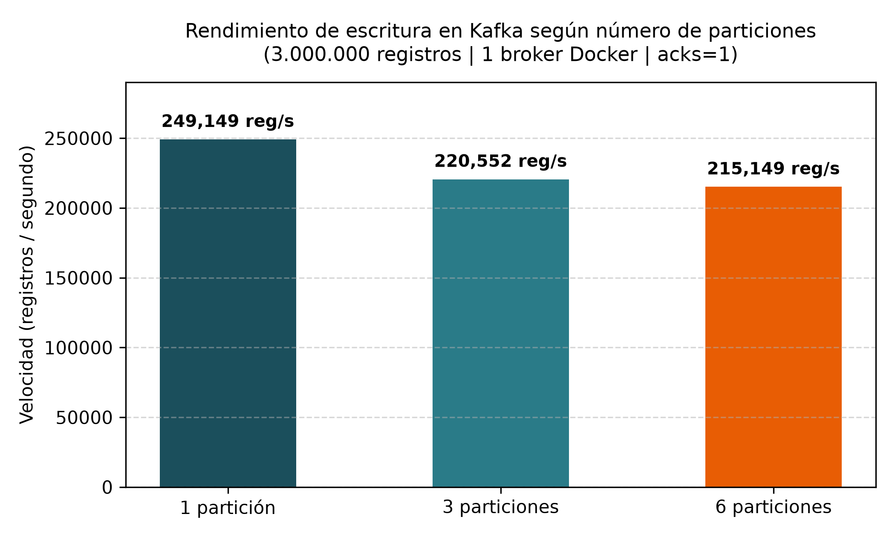

# Experimento 1: rendimiento de escritura según el número de particiones

**Encargada:** Isidora Martínez

---

## 1. Información general

**Pregunta:** ¿Cómo cambia la velocidad de escritura (*throughput*) de Apache Kafka al aumentar la cantidad de particiones de un tópico?

**Hipótesis:** Al aumentar el número de particiones de un tópico (de 1 a 3 y 6), la velocidad de escritura en registros por segundo aumentará porque Kafka puede distribuir y escribir los lotes de mensajes en paralelo, aunque en un entorno de un solo nodo (1 broker) la mejora eventualmente se estabilizará por los límites de CPU y disco del equipo.

| Elemento | Detalle |
|---|---|
| Variable que se modifica | Cantidad de particiones del tópico: `1`, `3` y `6` |
| Qué se mide | Velocidad de escritura en registros por segundo (`reg/s`) y tiempo total de ejecución (`s`) |
| Qué se mantiene fijo | 1 broker Kafka en modo KRaft (Docker), `replication-factor 1`, `acks=1`, `linger.ms=5`, `batch.size=65536`, mismo dataset (`Books_rating.csv`, 3.000.000 de registros) y el mismo equipo |
| Configuraciones evaluadas | 3 tópicos independientes (`exp-p1`, `exp-p3` y `exp-p6`) sobre los 3.000.000 de registros completos (además de una prueba piloto previa con 300.000 registros) |
| Herramienta de medición | Script propio en Python (`exp1_rendimiento.py`) usando la librería `confluent-kafka` |


## 2. Datos del experimento

El script `exp1_rendimiento.py`:

1. Abre `Books_rating.csv` en modo binario (`rb`) para leerlo línea por línea en *streaming* sin saturar la memoria RAM.
2. Omite la primera fila correspondiente a los encabezados del CSV.
3. Envía cada registro como mensaje al tópico correspondiente sin clave (*key*) para que Kafka reparta los lotes entre todas las particiones disponibles.
4. Mide el tiempo exacto con `time.perf_counter()` hasta completar el `flush()` final y calcula la velocidad en registros por segundo (`registros / duración`).

Se realizó primero una ejecución piloto con `MAX_RECORDS = 300_000` para validar el entorno y luego la ejecución definitiva con `MAX_RECORDS = None` para procesar los **3.000.000 de registros completos** (~2,86 GB) en cada configuración.

---

## 3. Paso a paso

> Todos los comandos se ejecutan desde la terminal del computador, ubicados dentro de la carpeta de trabajo (`experimento1/`).

### Paso 1. Levantar el contenedor de Kafka

Asegúrate de tener Docker Desktop abierto y `docker-compose.yml` en la carpeta:

```bash
docker compose up -d
docker ps
```

*(Espera unos 10 segundos para que el broker en modo KRaft termine de inicializar).*

### Paso 2. Crear un tópico por configuración

```bash
docker exec kafka /opt/kafka/bin/kafka-topics.sh --create --topic exp-p1 --partitions 1 --replication-factor 1 --bootstrap-server localhost:9092
docker exec kafka /opt/kafka/bin/kafka-topics.sh --create --topic exp-p3 --partitions 3 --replication-factor 1 --bootstrap-server localhost:9092
docker exec kafka /opt/kafka/bin/kafka-topics.sh --create --topic exp-p6 --partitions 6 --replication-factor 1 --bootstrap-server localhost:9092
```

### Paso 3. Preparar el entorno virtual de Python

```bash
python3 -m venv venv
source venv/bin/activate
pip install confluent-kafka matplotlib
```

### Paso 4. Ejecutar el experimento

Primero se ejecutó una prueba piloto con `300.000` registros (`MAX_RECORDS = 300_000`) y luego se configuró el script con `MAX_RECORDS = None` para ingerir los 3.000.000 de registros completos:

```bash
python3 exp1_rendimiento.py
```

*(Si el archivo tiene `MAX_RECORDS = 300_000`, se puede cambiar a la ejecución completa en macOS con:)*

```bash
sed -i '' 's/MAX_RECORDS = 300_000/MAX_RECORDS = None/' exp1_rendimiento.py
python3 exp1_rendimiento.py
```

### Paso 5. Generar el gráfico de resultados

```bash
python3 generar_grafico.py
```

Esto crea la imagen `grafico_exp1.png` en la misma carpeta.

### Paso 6. Limpiar el contenedor y liberar espacio en disco

Para eliminar el contenedor y los ~9 GB temporales generados por las 3 corridas completas:

```bash
docker compose down -v
```

---

## 4. Resultados obtenidos

### Prueba piloto (300.000 registros)

| Configuración | Particiones | Registros enviados | Tiempo total (s) | Velocidad (registros/s) |
|---|---|---|---|---|
| Piloto 1 | 1 | 300.000 | 1,80 | 166.308,04 |
| Piloto 2 | 3 | 300.000 | 1,39 | 215.158,76 |
| Piloto 3 | 6 | 300.000 | 1,43 | 209.747,66 |

### Ejecución definitiva (dataset completo: 3.000.000 de registros / 2,86 GB)

| Configuración | Particiones | Registros enviados | Tiempo total (s) | Velocidad (registros/s) | Variación vs. 1 partición |
|---|---|---|---|---|---|
| Prueba 1 | 1 | 3.000.000 | 12,04 | 249.148,88 | Base (0%) |
| Prueba 2 | 3 | 3.000.000 | 13,60 | 220.552,01 | -11,48% |
| Prueba 3 | 6 | 3.000.000 | 13,94 | 215.148,92 | -13,65% |

**Conclusión:** En un entorno de un solo broker, aumentar las particiones de 1 a 3 y 6 redujo levemente la velocidad de escritura (-11,48% y -13,65%). Esto ocurre porque todas las particiones compiten por la misma CPU y el mismo disco físico: con 1 partición Kafka aprovecha al máximo la escritura secuencial en un único archivo (*append-only log*), mientras que con 3 y 6 particiones los lotes se fragmentan y aumenta la sobrecarga de gestión de archivos simultáneos. El escalamiento horizontal de escritura requiere múltiples brokers físicos; en un nodo único, el principal beneficio de tener más particiones se observa en la concurrencia de lectura (Experimento 3).

---

## 5. Gráfico de los resultados

